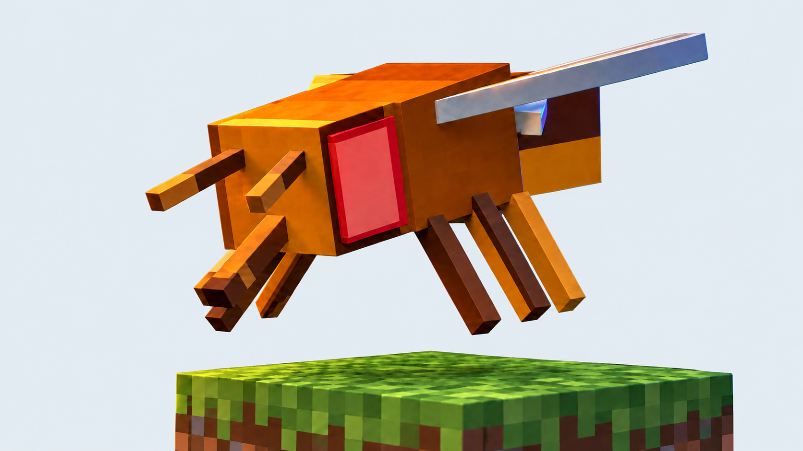
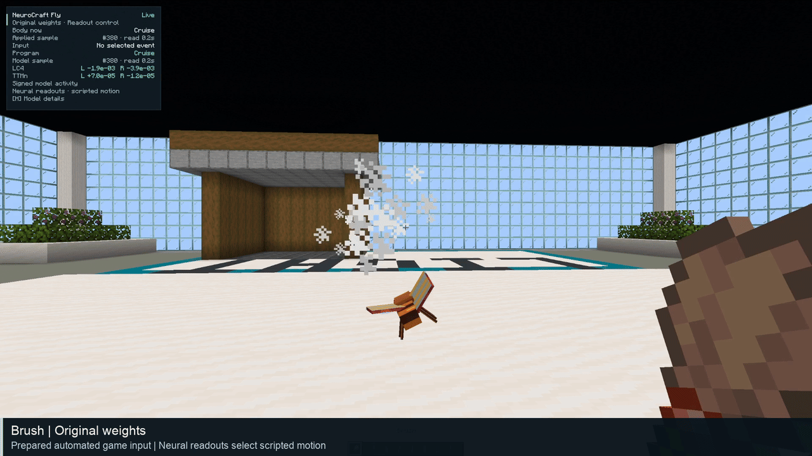

<p align="center">
  
</p>

<h1 align="center">NeuroCraft Fly</h1>

<p align="center"><b>An interactive fruit-fly connectome model in Minecraft.</b></p>

<p align="center">
  <a href="#demo">Demo</a> ·
  <a href="#two-ways-in">Two ways in</a> ·
  <a href="#quick-start">Quick start</a> ·
  <a href="#how-it-works">How it works</a> ·
  <a href="#what-has-been-observed">What has been observed</a> ·
  <a href="#read-the-model-honestly">Read the model honestly</a> ·
  <a href="#status">Status</a> ·
  <a href="#cite-this-project">Cite</a>
</p>

<p align="center">
  <a href="https://github.com/evnsnclr/neurocraft-fly-public/releases"></a>
  
  
  
  
  <a href="LICENSE"></a>
  <a href="https://github.com/evnsnclr/neurocraft-fly-public/actions/workflows/ci.yml"></a>
</p>

**NeuroCraft Fly runs leaky-rate dynamics on a retained MaleCNS v1.0 fruit-fly
connectome graph, 166,700 neurons and 25,582,938 directed edges, as the neural model
behind one custom Minecraft fly.**
Walk toward it, brush it, offer sugar, change the light, or bring a cow close: each
Minecraft event stimulates named model populations, hand-chosen neural readouts
select and modulate scripted body programs, and a compact HUD shows the active
condition and modeled activity; **H** opens model and experiment details. The
connectome supplies the wiring. The senses, the dynamics, the modeled signs, the
readouts and the body are declared modeling and engineering choices, and every
surface here says which is which.


<p align="center"><sub>The control path. A neural gate selects a program; it does not generate the program's movement. Minecraft supplies actor categories and event eligibility; the network does not infer them. Details in the <a href="docs/ARCHITECTURE.md">architecture</a> and the <a href="docs/MODEL_CARD.md">model card</a>.</sub></p>

## Demo

[](https://github.com/evnsnclr/neurocraft-fly-public/blob/main/media/neurocraft-demo.mp4)
<p align="center"><sub><b><a href="https://raw.githubusercontent.com/evnsnclr/neurocraft-fly-public/main/media/neurocraft-demo.mp4">Watch or download the full demo · 2:27 · 1080p / 30 FPS</a></b> · <a href="https://github.com/evnsnclr/neurocraft-fly-public/blob/main/media/README.md">recording notes and exclusions</a></sub></p>

Real Minecraft footage, edited from selected automated takes. The full video
includes six inputs, comparison conditions, restored-original brushing and a
separately labeled operator tour. It is not an uninterrupted human-played session.
These existing public media describe recorded source `87ebb97`, not qualification
of the later software candidate.

| Start | Chapter |
| --- | --- |
| 0:00 | Original weights: approach, brush, attack, food, mob and light |
| 0:42 | Shuffled weights, seed 7 |
| 1:20 | No sensory input |
| 1:54 | Original weights restored: brush |
| 2:01 | Operator-selected body-program tour |

## Two ways in

**Candidate `0.2.0-rc.7` is a source release candidate.** This repository holds the Fabric
mod and local neural service sources, the research kit and the curated documents;
it ships no packaged downloads. The Play route builds from source on Apple Silicon
macOS as a developer alpha, with installation and automated comparison runs so far
qualified only on the development Mac, for the earlier candidate `c1ff8b1`. The packaged Companion and its native
Windows port are implemented in this tree as private testing material: their bundles
are unqualified and unpublished. Read the
[release scope](docs/RELEASE_SCOPE.md) before setup.

| | **Play in Minecraft** (developer alpha) | **Explore the model in Python** (research kit) |
| --- | --- | --- |
| **Start** | [Build and run from source](docs/INSTALL.md) | [Research quickstart](docs/RESEARCH_QUICKSTART.md) |
| **What you use** | The Fabric mod, the local Python neural service and a fresh showcase world, built and launched from this source tree | Three notebooks and a reproducible example dataset |
| **Network** | Full retained MaleCNS: 166,700 neurons / 25,582,938 directed edges, derived locally from the separately acquired source tables | Attributed teaching fixture: 14 neurons / 22 directed edges |
| **Platform scope** | Apple Silicon macOS, with same-host installation and automated runs so far qualified only on the development Mac for the earlier candidate `c1ff8b1`; Linux experimental; Windows unqualified | Tested on the development Mac; broader qualification remains open |
| **You need** | Your own Minecraft Java account and matching Fabric client, plus the pinned Python and uv toolchain, Java 21, a C compiler, Git and Make | Pinned Python dependencies; no Minecraft, Java, native build or bulk download |
| **Then** | The [first brush interaction](docs/EXPERIMENTS.md#your-first-interaction), then [compare the conditions](docs/EXPERIMENTS.md#compare-the-conditions) and restore original weights | Inspect source annotations, stimulate the reference engine, then compare original weights, one seeded weight shuffle and no input |

The [Companion guide](docs/COMPANION.md) describes the private packaged route for
completeness; its bundles are not part of this release. Gameplay runs locally
without a hosted LLM or OpenAI API key; initial dependency and data acquisition
use the network. This alpha targets the documented local showcase; arbitrary
worlds and public multiplayer are outside its scope. The notebook outputs are
model experiments, not biological recordings or a reproduction of the full demo;
the [model card](docs/MODEL_CARD.md) separates the teaching example from the
full model and its engineered Minecraft interfaces. Use
[troubleshooting](docs/TROUBLESHOOTING.md) if setup fails.

## Quick start

Both routes need Python **3.13.18** and uv **0.13.6** exactly (`pyproject.toml` sets
`required-version`; use the standalone installer for that version, or
`pip install uv==0.13.6` inside a virtual environment). Verify an unaltered
export first:

```sh
python3 -I scripts/build_public_release.py --verify-source .
```

**Explore**, from the source root; no Minecraft, Java, native build or bulk download:

```sh
uv sync --frozen --all-packages --group research
uv run --frozen --group research python scripts/research_example.py verify
uv run --frozen --group research python scripts/run_research_notebooks.py \
  --output artifacts/research-notebooks-first-run
```

**Play**, on Apple Silicon macOS with Java 21, a C compiler, Git and Make. The
doctor is read-only; `setup` prints that revision's ordered plan and executes
nothing. Follow the printed plan rather than commands from another candidate:

```sh
python3 -I scripts/public_alpha.py doctor
python3 -I scripts/public_alpha.py setup
```

The plan synchronizes the frozen workspace, acquires and verifies the MaleCNS
source tables (about 1.1 GB), derives the full graph (about 591 MiB), builds the
native kernel, and points you to the Minecraft EULA; you record your own
acceptance only if you agree. Then build the mod and stage a private runtime:

```sh
cd mod
./gradlew --no-daemon --dependency-verification strict build
cd ..
python3 -I scripts/installed_mod.py --output artifacts/installed-runtime --mod-jar mod/build/libs/neurocraft-fly-0.2.0-rc.7.jar
```

Generate the patched launcher version, prepare and run the session, then join the
printed local address in the generated client version and wait for
**Live · Original weights · Readout control**. Every step, with its checks and
limits, is in the [installation guide](docs/INSTALL.md). The staged runtime
contains Minecraft: do not distribute it.

## How it works

1. **Senses.** The authoritative Minecraft server samples typed events and fields:
   player approach along sensor rays, contact, brush, attack attempt, food, light
   and a nearby mob. An engineered encoder maps them to declared model
   populations. These are software proxies, not reconstructed sensory
   transduction.
2. **Dynamics.** The Python neural runtime applies an explicit transmitter-to-sign
   policy and incoming normalization, then advances deterministic float64
   leaky-rate state on the retained 166,700-node, 25,582,938-edge graph, derived
   locally from the pinned MaleCNS v1.0 source tables.
3. **Readouts and policy.** Named population readouts (TTMn, DNa01, MN9 and
   antennal motor pools) are combined with observed source eligibility to select
   a program, under priorities, baselines, holds, cooldowns and cancellation.
4. **Body.** Java body programs (HOVER, CRUISE, BANK, LAND, WALK, GROOM, FEED,
   ESCAPE_JUMP, FLEE and APPROACH) run as scripted motion under bounded thrust
   and torque. The logical server owns entity state, program preconditions and
   physics; an issued program can be refused or expire before it applies.
5. **Bridge and HUD.** A loopback-only authenticated bridge binds graph and
   controller identities, sequences and ticks, and keeps I/O and neural execution
   off the game thread. The client HUD renders actual model samples and labels
   the network condition and control authority, distinguishing the current body
   state, applied command samples and separately sequenced neural samples.

Comparisons run under three labeled conditions: original weights, shuffled
weights (a seeded permutation of counts on existing edges, which does not rewire
endpoints) and no input, with explicit original-state restoration. The
[architecture](docs/ARCHITECTURE.md), the [model card](docs/MODEL_CARD.md) and the
[experiments guide](docs/EXPERIMENTS.md) carry the equations, populations,
procedures and limits.

## What has been observed

Full-network gameplay has been recorded on the development Mac. A production-JAR
connection/HUD smoke also ran on that host. Independent first-user installation,
normal account/launcher flow and sustained manual play on the final candidate
remain release checks, not established outcomes.

The compact-HUD showcase has selected automated takes across original,
shuffled-weight and no-input conditions. In those takes, seed-7 shuffling retained
five of six target responses; none of the six corresponding target responses
appeared with sensory input disabled. Baseline cruise can still move the body.
Histories differ between takes; failed preparations and stalled capture sections
were retained privately and disclosed in the recording notes. This is an
illustration, not a repeated matched-input benchmark or biological validation.

Earlier source `9f7b13e` completed 18 qualified original trials and a
720.050-second walkthrough. Six native-input control trials were excluded;
shuffled light retained its response among qualified controls. Ten late
retirements and thirteen sampled readout stalls occurred, without a recorded
terminal bridge fault. A separate fixed-60 schedule missed every forward sensor
ray and establishes no suppression. Those results retain their original build
and scope; the [model card](docs/MODEL_CARD.md#evidence-and-limits) summarizes them.

## Read the model honestly

The source reconstruction supplies connectivity and neuron annotations.
Sensors, dynamics, modeled signs, readout mappings and Minecraft movement are
declared modeling and engineering choices.

- A historical readout on a **128-neuron, 887-edge fixture** had **95.66× raw /
  403.70× bounded MSE** relative to a matched direct controller on synthetic
  open-loop imitation. This did not test full-network or closed-loop navigation
  ([ADR 0038](docs/adr/0038-trained-readout-result-scope.md)).
- The **offline** escape diagnostic measured DNp01 about **300×** the wing-pool
  response and TTMn **35.1×** its near-silent baseline in **four neural steps**.
  This is not measured live reaction timing.
- **Hand-chosen readouts select and modulate scripted body programs.** The HUD
  separates applied samples from model samples and labels the active condition
  and control authority. Missing matching evidence stays unavailable.

See H details, [ADR 0019](docs/adr/0019-pivot-to-interactive-connectome-demo.md)
and the [offline escape receipt](docs/receipts/ESCAPE-ARC-01.md). The
[evidence guide](docs/EVIDENCE.md) explains retained history and omitted private
support material. No recovered physiology, natural behavior, intelligence or
consciousness is established.

## Status

| Aspect | State |
| --- | --- |
| **Candidate** | `0.2.0-rc.7`, a source release candidate published as a GitHub pre-release; the archive verifies against the `RELEASE_MANIFEST.json` it carries ([release scope](docs/RELEASE_SCOPE.md), [roadmap](docs/ROADMAP.md)) |
| **Play** | A developer alpha built from source on Apple Silicon macOS; installation and automated comparison runs qualified only on the development Mac, for the earlier candidate `c1ff8b1`; no packaged download |
| **Explore** | The research kit: three notebooks and a reproducible example on the attributed 14-neuron fixture, tested on the development Mac |
| **Not yet observed** | Independent installation through the documented route, a sustained human-played session and footage of this exact candidate; these release checks stay open and no playable claim is made |
| **Other platforms** | Linux experimental; native Windows and the packaged Companion are private testing material, unqualified and outside this release |
| **Dependency audits** | `pip-audit` passes with its one documented pyarrow exception, and the fail-closed OSV scan of the Gradle lock passes; 34 scoped advisory exceptions for Java components pinned by Minecraft 1.21.5 and Loom 1.10.5 expire on 2027-01-31 ([SECURITY.md](SECURITY.md)) |
| **Media** | The demo footage describes recorded source `87ebb97`, not this candidate |

## Cite this project

Smith, E. (2026). *NeuroCraft Fly*. [Project landing page](https://github.com/evnsnclr/neurocraft-fly-public).

```bibtex
@misc{smith2026neurocraftfly,
  author = {Smith, Evan},
  title = {{NeuroCraft Fly}},
  year = {2026},
  url = {https://github.com/evnsnclr/neurocraft-fly-public},
  note = {Project landing page; source release candidates are published as GitHub pre-releases}
}
```

[Download the project BibTeX](https://github.com/evnsnclr/neurocraft-fly-public/blob/main/CITATION.bib)
or use [CITATION.cff](CITATION.cff). This landing-page citation does not pin a
specific release. When using candidate code, record its version and the exact
source revision too (`CITATION.cff` carries the current candidate version). Cite
the underlying MaleCNS reconstruction
separately as described in [credits](docs/CREDITS.md).

## Participate

Created by [Evan Smith](https://github.com/evnsnclr). Start with the
[roadmap](docs/ROADMAP.md), [contributing guide](CONTRIBUTING.md) and
[community code](CODE_OF_CONDUCT.md). Questions and reproducible bug reports
belong in repository issues when enabled. For sensitive findings, follow
[SECURITY.md](SECURITY.md): private vulnerability reporting is enabled on the
public repository, so keep exploit details out of public issues.

Project software and associated documentation use the [MIT License](LICENSE).
Third-party software, data and assets retain their separate terms; see
[credits](docs/CREDITS.md) and [third-party notices](THIRD_PARTY.md). MaleCNS
v1.0 data are credited to FlyEM (HHMI Janelia), the University of Cambridge
Department of Zoology, the MRC Laboratory of Molecular Biology and Google
Research, under CC BY 4.0. Minecraft binaries, account material and bulk
connectome data are not included.

NeuroCraft Fly is not an official Minecraft product and is not approved by or
associated with Mojang or Microsoft.
