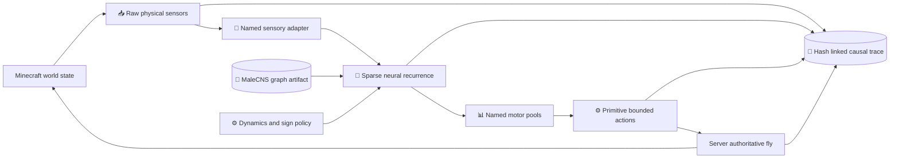

# NeuroCraft Fly architecture

_Research-gate design accepted 2026-08-16; implementation/evidence state refreshed 2026-08-17_

---

## 📋 Evidence state

This document records the selected architecture and its current implementation boundary. Design intent comes from the ADRs; current artifact and run claims come only from the linked receipts.

> ⚠️ **Current boundary, updated 2026-08-18:** G0, G1, fixture-scope G2, and fixture-scope G3 are passed at named scopes. The attributed 14-node/22-edge `mcns-v1.0-flight-power-v1` fixture is reproducible; full artifact `male-cns-v1.0-superclass-v1` passed G1; deterministic fixture dynamics/replay passed G2. Fixture-scope G3 is promoted (D-027) on `EXTERNAL-BRIDGE-03` exact replay with world cross-links plus the complete `AB11-MUTANTS-01` test-power suite; `EXTERNAL-BRIDGE-04` continues that evidence line on the security-remediated tree, and `-01` through `-03` are historical. G3-R, full-graph execution, G4, G5, and G6 remain open.

The selected target is the public `male-cns:v1.0` release. [`ACQ-MCNS-01`](./receipts/ACQ-MCNS-01.md) and [`FIXTURE-MCNS-01`](./receipts/FIXTURE-MCNS-01.md) establish source hashes, bounded fixture lineage, exact counts, and the fixture's redistribution posture. [`RUNTIME-MCNS-01`](./receipts/RUNTIME-MCNS-01.md) establishes G1 for manifest `b33bdda8…f67c98c`: 166,700 nodes, 25,582,938 directed edges, raw weight 124,177,617, and 619,324,920 array bytes, with byte-identical rebuilds. Its unsigned all-edge smoke averaged about 0.229 seconds per step and therefore does not support full-graph real-time wording.

[`EXTERNAL-BRIDGE-01`](./receipts/EXTERNAL-BRIDGE-01.md) records one historical protocol-v1 opt-in automated fixture-scale run. [`EXTERNAL-BRIDGE-02`](./receipts/EXTERNAL-BRIDGE-02.md) records the current protocol/trace-v2 bounded candidate: nine exactly replayed actions, eight pre-actuation and seven next-tick world cross-links, and 9/9 state/action divergence with 9/9 neutral actions under zero recurrence. Neither is a normal launcher observation, Minecraft-physics replay, long soak, G3-R, G4 result, or full-toolchain reproduction.

The research-synthesis gate and the scientific claim ladder are distinct:

- the **research synthesis** fixes the components, boundaries, failure behavior, and evidence requirements so implementation may begin;
- the **claim ladder** advances only when named artifacts/runs and reviews satisfy the gates in [ADR 0005](./adr/0005-fixture-and-claim-gates.md); a run manifest's target scope is not itself promotion.

## 🎯 Architectural invariant

Faithful Organism Mode has exactly one action-selection path:

`raw Minecraft sensors -> named sensory adapter -> deterministic sparse recurrence -> named motor pools -> primitive actions`

The following paths are forbidden in Faithful Organism Mode:

- raw observations, target vectors, object categories, or world queries reaching the motor decoder or actuator
- vanilla goals, navigation, pathfinding, player input, scripts, language models, behavior trees, or stale commands selecting movement
- learned edge weights, neuron embeddings, MLP/GRU/attention updates, arbitrary all-neuron readouts, imitation, or reward-trained policies
- semantic motor macros such as `approach`, `avoid`, `takeoff`, `land`, heading hold, hover, or collision recovery
- client rendering, the HUD, telemetry summaries, or operator input changing authoritative control state

Resets may place the entity at an absolute fixture coordinate. Ordinary locomotion may use only declared bounded thrust, torque, rotation, and Minecraft physics.

## 🏗️ Component boundaries

| Component | Authority | Required responsibility | Prohibited responsibility |
|---|---|---|---|
| **Dataset acquisition** | Offline Python/tooling | Verify immutable source files, terms, hashes, schemas, counts, and attribution | Mutable `latest` data or live API state as runtime authority |
| **Canonical graph builder** | Offline Python/tooling | Preserve stable body IDs, raw counts, direction, exclusions, metadata provenance, and deterministic ordering | Silent fuzzy ID matching, unexplained filtering, or source mutation |
| **Runtime graph view** | Python neural service | Load a content-addressed sparse graph plus explicit sign/normalization/delay overlays | Editing source topology or hiding inactive/unknown-sign edges |
| **Sensory adapter** | Python neural service | Map versioned raw physical values through sparse affine/saturation rules to named boundary populations | Target selection, classification, steering, action state, or motor output |
| **Neural engine** | Python neural service | Advance synchronous deterministic sparse leaky-rate state on integer neural steps | Wall-clock-dependent integration or an undeclared learned policy |
| **Motor decoder** | Python neural service | Pool only named motor/descending populations and apply declared gain/dead-zone/clip/smoothing | Reading raw observations or arbitrary whole-state policy features |
| **Bridge** | Java client and Python server | Enforce protocol, identity, order, size, deadlines, bounded queues, and failure state | Blocking the game thread or accepting stale/wrong-session actions |
| **Fly entity** | Minecraft logical server | Own pose, physics, sensor sampling, validated actuation, reset, and authoritative transition data | Vanilla AI, navigation, client-authoritative movement, or action macros |
| **Renderer and HUD** | Minecraft client | Render an original Drosophila and read-only bounded summaries | Feeding presentation state back into control |
| **Trace writer** | Off-thread runtime service | Persist the mandatory hash-linked causal record and checkpoints | Silently dropping required records or logging credentials/private game data |

## 📦 Authoritative pins

The following tuple supersedes the earlier provisional 1.21.1 and third-party Java-WebSocket suggestions recorded in the public-code/reuse research:

| Layer | Selected identity | Status |
|---|---|---|
| **Connectome target** | Janelia `male-cns:v1.0` | Verified sources, tracked fixture, and ignored named full artifact with G1 receipt |
| **Minecraft** | Java Edition `1.21.5` | Automated server/client/GameTest execution observed; after user EULA acceptance, `LIVE-CIRCUIT-01` observed a headless normal development server under fixture-circuit control. Production-JAR/manual-client observation remains open |
| **Java** | `21` | Project and tests compile/run on the pinned toolchain |
| **Fabric Loader** | `0.16.10` | Resolved, locked, and strict-checksum verified |
| **Fabric API** | `0.128.2+1.21.5` | Resolved, locked, and strict-checksum verified |
| **Fabric Loom** | `1.10.5` | Resolved and locked; generated mappings require exact local-derived checksum regeneration for a fresh Loom cache |
| **Gradle** | wrapper `8.12` | Wrapper committed and distribution checksum pinned; no system Gradle required |
| **Java transport** | JDK 21 `java.net.http.WebSocket` client | Implemented and integration-tested; no Java-WebSocket dependency |
| **Python transport** | `websockets==17.0.1` server | Frozen in `uv.lock`, loopback-only, authenticated, bounded, and integration-tested |
| **Mappings** | Loom official Mojang mappings | Resolved through Loom; proprietary/decompiled game material is not committed |

`uv.lock`, Gradle dependency locks, strict verification metadata, license inventory commands, and a reproducible Python CycloneDX SBOM now exist. External JVM artifacts and metadata remain checksum verified. Four exact/mapping-specific trust rules cover only Loom-local generated JARs whose outer ZIP hashes vary with cache timestamps; fresh Gradle-home server and client builds passed strict verification. This is a reviewed local-derivation boundary, not a waiver for remote dependency groups. Version pins alone are never execution evidence.

## ⚙️ Dynamics and clock contract

The baseline neural engine is the deterministic recurrence in [ADR 0002](./adr/0002-neural-dynamics.md). It uses immutable source edge support and raw counts, a declared sign policy, incoming normalization, one activity-deviation value per neuron, synchronous updates, a one-step causal delay, and no unseeded noise.

The fixture controller implements this clock contract:

1. Minecraft samples one observation and applies at most one new action per nominal 50 ms server tick.
2. The neural service initially tests five fixed 10 ms substeps for each game tick.
3. The observation is held constant during those substeps; motor pools are sampled after the final committed substep.
4. Integer tick and step indices are authoritative. Wall-clock timestamps are diagnostic only.
5. The game thread never waits for Python, serialization, disk, or neural work.

Numerical convergence and end-to-end latency determine the accepted neural rate. The verified external run used the 14-node/22-edge MaleCNS-derived fixture. The measured full artifact misses the live step budget, so it remains a slowed/offline engineering scope. The project may not skip steps, prune edges, change equations, or narrate fixture execution as full MaleCNS execution.

The CPU single-thread sparse implementation is the reference backend. Sorted CSR-like arrays and fixed accumulation order define replay. Threaded, device, or event-driven backends are optional only after parity and performance gates pass.

## 🔐 Minecraft and bridge contract

The Java mod implements a custom direct entity rather than a bee or other vanilla proxy. The logical server owns behavior and physics; the client owns only the original fly renderer and overlay. Goal/target navigation is absent. Neutral or disconnected operation is designed and tested to produce no intentional motion beyond logged passive physics.

The Java mod is the WebSocket client and the Python neural process is the loopback server. Current `neurocraft.protocol.v2` requires:

- binding to `127.0.0.1` or `::1`, never all interfaces by default
- a negotiated protocol version and per-run authentication token
- matching run, session, entity, graph, adapter, dynamics, and decoder identities
- monotonic observation and command sequences tied to Minecraft ticks and neural-step ranges
- compression disabled, a 64 KiB message ceiling, and strict JSON schema/finite-number validation
- a one-slot latest-observation handoff, a bounded two-entry action window, and no unbounded queue
- rejection of malformed, oversized, duplicate, future, wrong-session, wrong-hash, and over-age messages before entity mutation
- off-thread I/O and parsing, followed by server-thread command validation and application

Protocol fields ending in `_m` or `_m_s` use engineering coordinates: one Minecraft
block is treated as one engineering metre, and game velocity is converted from
blocks per tick by multiplying by the 20 Hz game-tick rate. These names are an
interface convention, not a physical calibration of Minecraft or fly motion.

Timeout, disconnect, non-finite state, identity mismatch, missed mandatory trace, or invalid ordering transitions the run to `PAUSED_FAULT` by the next game tick. The entity receives neutral actuation, controller-owned targets/accelerations are cleared, vanilla AI stays disabled, and the run cannot silently resume under the old session epoch.

## 📊 Causal trace and replay

The authoritative evidence is the immutable, hash-linked control trace defined in [ADR 0004](./adr/0004-causal-trace-and-replay.md), not the HUD, a screenshot, a video, or a ReplayMod file.

Each control record binds:

- raw server observation and sensor schema
- named sensory stimulation
- neural step range, interventions, state digest, and checkpoint reference
- named motor-pool values and decoder identity
- received command, validated/clamped action, action age, and rejection reason
- authoritative entity/world transition and passive-force fields
- protocol sequences, fault state, timing counters, and the preceding record hash

A mandatory-record persistence failure invalidates the run and fails closed. Same-build neural replay reconstructs the encoded inputs, state/action digests, and faults from recorded observations. Current `EXTERNAL-BRIDGE-02` contains nine records (`command_seq` 0–8, ticks 6–14), eight exact pre-actuation and seven next-tick world cross-links, one terminal receipt-only pre-state, and two terminal hash-authenticated transitions that are explicitly not independently cross-linked. Python replay does not re-simulate Minecraft physics. Counterfactual replay keeps the recorded sensor stream fixed while changing only a declared graph/sign/lesion control. Historical protocol-v1 `EXTERNAL-BRIDGE-01` retains the earlier eight-record evidence separately.

## 🧪 Verification and claim boundary

Verification proceeds in this order:

| Stage | Eligible evidence | Ineligible interpretation |
|---|---|---|
| **Synthetic algebra** | Equations, delays, signs, sequence validation, faults, trace hashing | MaleCNS provenance or biological behavior |
| **Extracted MaleCNS fixture** | Source IDs/rows, deterministic ingestion, small-graph recurrence and causal path | Full-CNS execution or adult-fly behavior |
| **Coherent circuit** | Closed-loop ownership, adapters, primitive actuation, launcher integration | Whole-MaleCNS or real-time full graph |
| **Full pair graph** | Full retained topology execution after G1/G2 receipts | Real time until measured soak gates pass |
| **Held-out controls** | Topology/weight contribution under fixed interfaces | Natural fly behavior or recovered physiology |
| **Biological comparison** | Consistency with one preregistered named response | Population generality, whole fly, consciousness, or brain upload |

Synthetic data remains necessary for broad early CI scenarios even though the bounded biological fixture now exists. Synthetic artifacts must be visibly named `synthetic` and must never be packaged, displayed, or logged as MaleCNS-derived. The attributed MaleCNS fixture may support only its declared structural scope. [ADR 0005](./adr/0005-fixture-and-claim-gates.md) defines the promotion gates and permissible wording.

## 🔗 Decision and research index

Accepted architecture records:

- [ADR 0001: Connectome data](./adr/0001-connectome-data.md)
- [ADR 0002: Neural dynamics](./adr/0002-neural-dynamics.md)
- [ADR 0003: Minecraft and transport](./adr/0003-minecraft-and-transport.md)
- [ADR 0004: Causal trace and replay](./adr/0004-causal-trace-and-replay.md)
- [ADR 0005: Fixture and claim gates](./adr/0005-fixture-and-claim-gates.md)

Research basis:

- [Connectome dataset decision](./research/connectome_dataset_decision.md)
- [Executable neural-system decision](./research/neural_model_decision.md)
- [Minecraft architecture decision](./research/minecraft_architecture_decision.md)
- [Systems and performance plan](./research/performance_plan.md)
- [Scientific red-team review](./research/scientific_red_team.md)
- [Original-project forensics](./research/original_project_forensics.md)
- [Public-code audit](./research/public_code_audit.md) and [reuse matrix](./research/reuse_matrix.md)
