# ADR 0004: Make the causal trace immutable and replayable

_Evidence, recovery, and replay contract, accepted 2026-08-16_

---

| Field | Value |
|---|---|
| **Status** | Accepted and implemented; trace-v2 verified, G3 promotion still open |
| **Date** | 2026-08-16 |
| **Authority** | Server-aligned hash-linked control records |
| **Presentation status** | HUD, screenshots, video, and ReplayMod are non-authoritative |
| **Research basis** | [Systems and performance plan](../research/performance_plan.md) |

The status above is current. The implementation now enforces immutable
hash-linked trace-v2 records, receipt/world-state lineage, cumulative
claim-scope policy, exact neural replay, and counterfactual replay. The bounded
`EXTERNAL-BRIDGE-02` run is candidate evidence only; it does not close G3,
world-physics replay, the AB-11 mutant suite, or the real-time qualifier.

## 📋 Context

A moving entity and animated neural overlay can remain convincing even when the connectome is dead, bypassed, stale, or decorative. Evidence must bind what the server observed, what named neurons were stimulated, what neural interval executed, what motor pool was read, what action passed validation, and what world transition followed.

The trace must also support restart recovery, corruption detection, causal replay, counterfactual controls, and reconstruction of every displayed value without placing file I/O on the Minecraft tick thread.

## 🎯 Decision

Every acceptance-capable run writes an append-only, versioned, hash-linked causal trace. A finalized chunk is immutable by contract: its content hash and chain links make modification, deletion, insertion, or reordering detectable. The run manifest binds data, graph, code, configuration, schemas, clocks, platform, and seed.

```mermaid
flowchart LR
    accTitle: Causal Trace And Replay
    accDescr: Each game tick records observation, encoded stimulation, neural evolution, motor decoding, applied action, and world transition into a hash chain that drives deterministic replay and counterfactual checks.

    observe_tick["📥 Record raw observation"] --> encode_sensors["🔌 Record named stimulation"]
    encode_sensors --> advance_neural["🧠 Record neural interval"]
    advance_neural --> decode_motor["📊 Record motor pools"]
    decode_motor --> apply_action["⚙️ Record applied action"]
    apply_action --> world_transition["Record world transition"]
    world_transition --> append_chain[("📝 Append hash chain")]
    append_chain --> replay_check["🔄 Replay and compare"]
```

Tick and neural-step order are authoritative. Monotonic and wall-clock times are diagnostic fields only.

## 📝 Manifest and record schema

The run manifest contains at least:

- trace schema and protocol versions
- run ID, initial session epoch, mode, and declared claim scope
- source file, canonical graph, runtime graph, fixture, code, dependency-lock, adapter, dynamics, sign, decoder, arena, and configuration hashes
- game and neural clock policy, units, precision, backend, thread settings, seed, and determinism level
- machine, OS, Java, Python, Minecraft, Fabric, and mod identities
- privacy/redaction policy, expected chunks, and checkpoint policy

Each tick record contains at least:

| Record group | Required content |
|---|---|
| **Chain identity** | schema, run/session, record sequence, prior-record hash |
| **Clock identity** | Minecraft tick, neural step start/end, observation/action age |
| **Observation** | raw server sensor values, schema hash, units, missing/clamp flags |
| **Encoding** | named source body IDs/populations, encoded values, adapter hash |
| **Neural execution** | state-before/after digests, interventions, delay/RNG digest, checkpoint reference |
| **Decoding** | named motor-pool raw values, pool membership hash, decoder output/config hash |
| **Application** | received command, validation result, clamp, applied primitive action, neutral/fault reason |
| **World result** | authoritative pose/velocity/orientation/contact transition and logged external/passive forces |
| **Operations** | message sequences, queue/coalescing/overrun counters, compute/serialization/write timings, fault state |

Full state is retained for synthetic and small-fixture traces. Full-graph runs may use deterministic checkpoints, chunk hashes, selected probes, and state digests, but downsampling must be declared and omitted state may not be reconstructed or displayed as if observed.

## 🔐 Durability and privacy

- The tick thread enqueues a bounded record envelope; an off-thread writer serializes and rotates chunks.
- Each chunk records its tick range and SHA-256 in a content-addressed index.
- Checkpoints include mutable neural state, delay buffers, seeded RNG state, neural step, accepted sequences, and rolling trace hash; immutable graph arrays are referenced, not duplicated.
- Checkpoints are written to a temporary path, flushed, hashed, and atomically promoted.
- Queue overflow or inability to persist a mandatory record marks the run invalid and triggers fail-closed neutral actuation.
- Tokens, account material, chat, unrelated player/world data, absolute user paths, and server secrets are prohibited from scientific traces.
- A dashboard or video must be reproducible from trace fields and cannot introduce hand-authored neural/action values.

## 🔄 Replay contract

### Neural replay

Feed recorded raw observations and interventions to a fresh neural process with matching identities. Same-build/reference-backend replay must reproduce encoded stimulation, state digests, motor values, applied-action candidates, and fault sequence exactly.

### World replay

Reset the deterministic arena and apply the accepted recorded primitive actions without the live neural service. Compare authoritative pose, velocity, orientation, collision, and passive-force traces under a declared tolerance. This isolates Minecraft determinism from neural determinism.

### Counterfactual replay

Keep raw observations, timing, arena, adapter, decoder form, and actuator limits fixed while changing exactly one declared graph/sign/lesion/null condition. The trace must carry a new configuration identity. This is the primary route for zero, frozen, shuffled, rewired, sign, and lesion controls.

### Recovery replay

After process loss, verify all immutable identities, load the newest valid checkpoint, replay durable records after it, compare each state/action digest, and create a new session epoch at a tick boundary. If replay diverges, start a new marked run rather than branching an unmarked history.

## ⚡ Consequences

### Positive

- Causal claims can be audited without trusting presentation.
- Corruption, stale sessions, and missing records become detectable.
- Neural, world, and counterfactual replay isolate different failure sources.
- Recovery cannot silently continue a divergent state.

### Negative

- Mandatory telemetry becomes part of the controller's validity boundary.
- Full-state recording is too large for default full-graph runs, requiring checkpoints/digests and explicit probe budgets.
- Cross-hardware floating-point parity needs tolerances even when same-build reference replay is exact.

## 🔍 Rejected alternatives

- **Video or ReplayMod as scientific record:** presentation evidence lacks neural and validation state.
- **HUD-only logging:** client values are non-authoritative and may be decoupled from applied action.
- **Mutable CSV summary:** lacks chain integrity, checkpoints, and complete causal fields.
- **Best-effort telemetry:** a dropped causal record makes the run unauditable and therefore invalid.

## 🧪 Promotion evidence

Tests must corrupt, delete, duplicate, and reorder records; overflow the writer queue; kill each process at protocol/checkpoint boundaries; corrupt the newest checkpoint; and verify that CI fails on a missing trace chunk. Replay claims require receipts with exact artifact identities, test counts, tolerances, and every divergence.

## 🔗 References

- [Architecture overview](../ARCHITECTURE.md)
- [ADR 0002: Neural dynamics](./0002-neural-dynamics.md)
- [ADR 0003: Minecraft and transport](./0003-minecraft-and-transport.md)
- [Systems and performance plan](../research/performance_plan.md)
- [Scientific red-team review](../research/scientific_red_team.md)
