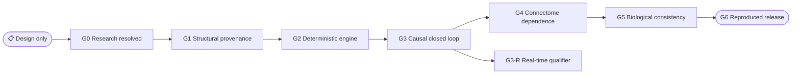

# ADR 0005: Separate fixtures from scientific claim gates

_Promotion and evidence policy, accepted 2026-08-16_

---

| Field | Value |
|---|---|
| **Status** | Accepted policy; G0/G1, fixture G2, and fixture G3 passed; G3-R and stronger gates open |
| **Date** | 2026-08-16 |
| **Research synthesis** | Architecture selected; G0 and named G1 passed 2026-08-17 |
| **Scientific promotion** | Fixture-scope G3 passed 2026-08-18 (D-027); G3-R and stronger gates remain open |
| **Research basis** | [Scientific red-team review](../research/scientific_red_team.md) |

## 📋 Context

Tests can pass for a hand-authored graph while the real dataset is absent, and a moving fly can succeed while a decoder, actuator, vanilla goal, stale command, or arena supplies the behavior. Fixture identity and claim strength must therefore be explicit and machine-checkable.

Creating the synthesis ADRs completes the architecture-selection requirement in [ADR 0000](./0000-research-before-implementation.md). It does not itself satisfy the red-team claim ladder. In particular, authoritative versions are now selected, but the MaleCNS acquisition, rights receipt, and extracted fixture required to close G0 remain outstanding.

## 🎯 Decision

Every test, run, dashboard, manifest, and report declares one fixture tier and one maximum eligible claim gate. Synthetic and biological artifacts may share schemas and engines but never identities, labels, hashes, or claim wording.

Claims are cumulative. A higher gate includes lower-gate evidence, and a failure blocks only the stronger wording rather than erasing valid lower-level engineering results.

## 🧪 Fixture tiers

| Tier | Identity | What it may prove | What it cannot prove |
|---|---|---|---|
| **Synthetic algebra** | Hand-authored 1-, 2-, 4-, and small adversarial graphs | Equations, signs, delays, masks, protocol, faults, trace/replay, harness power | MaleCNS provenance, anatomical path, biological effect, full performance |
| **Synthetic capacity** | Deterministic sparse graphs with declared size/degree distributions | Memory/kernel/queue scaling and failure behavior | Actual MaleCNS counts, topology, real-time eligibility |
| **MaleCNS extracted CI** | Future `mcns-v1.0-flight-power-v1` with exact source lineage | Source schema, IDs, weights, signs, bilateral path, deterministic biological-fixture execution | Full graph, whole CNS, natural behavior |
| **MaleCNS coherent circuit** | Future source-derived named subsystem | Initial live causal loop, adapter/actuator ownership, circuit interventions | Full MaleCNS execution or population biology |
| **MaleCNS full pair graph** | Future canonical retained v1.0 runtime artifact | Full structural runtime after G1/G2 and benchmarks | Whole body, recovered physiology, natural behavior by itself |

> ⚠️ **Hard boundary:** no MaleCNS-derived fixture exists at this decision date. Synthetic CI data cannot substantiate G1, even if it uses realistic names, counts, distributions, or copied schema fields.

> ✅ **Evidence update, 2026-08-17:** `mcns-v1.0-flight-power-v1` now exists as an attributed 14-node/22-edge extracted CI artifact with exact source rows and two byte-identical fresh-cache builds. This closes G0's fixture prerequisite, not G1's runtime-graph requirements.

The test harness must reject a synthetic artifact whose manifest claims a MaleCNS source identity. Dashboards and videos must display `SYNTHETIC`, `MALECNS_FIXTURE`, `MALECNS_CIRCUIT`, or `MALECNS_FULL` from the verified run manifest rather than a user-entered label.

## 📊 Gate status at synthesis

| Gate | Synthesis-time availability (historical, not current gate status) | Missing promotion evidence |
|---|---|---|
| **Architecture synthesis** | Accepted | No implementation claim follows |
| **G0 — research resolved** | Open | Verified MaleCNS file/rights manifest and successfully extracted fixture, or an explicit fallback ADR |
| **G1 — structural provenance** | Unavailable pending prerequisites | Downloads, source/derived hashes, counts/attrition, row lineage, runtime identity refusal |
| **G2 — deterministic engine** | Unavailable pending prerequisites | Implemented analytic tests, real extracted fixture trace, full graph execution/observability/benchmark |
| **G3 — causal closed loop** | Unavailable pending prerequisites | Anti-bypass A-01 through A-09, authoritative trace, custom entity and primitive actuator evidence |
| **G3-R — real-time qualifier** | Unavailable pending prerequisites | Named-hardware 10,000-interval latency/queue/step-drop soak after G3 |
| **G4 — connectome-dependent behavior** | Unavailable pending prerequisites | Held-out paired trials and matched zero/frozen/shuffled/rewired/baseline controls |
| **G5 — limited biological correspondence** | Unavailable pending prerequisites | Independent compatible fly target, a priori prediction, matched lesions, sensitivity controls |
| **G6 — reproducible release/demo** | Unavailable pending prerequisites | Cold acquisition/build/run, SBOM/rights, all receipts, continuous demo, dual replay |

As of the 2026-08-18 evidence refresh, G0 and G1 are passed at their named scopes, G2 is passed for the source-derived fixture controller, and G3 is passed at fixture scope (D-027) on `EXTERNAL-BRIDGE-03` plus the complete `AB11-MUTANTS-01` suite with its independent review. `EXTERNAL-BRIDGE-01` and `EXTERNAL-BRIDGE-02` are historical. G3-R and stronger gates remain open. The table retains the earlier synthesis-time availability snapshot for audit history; it is not a current promotion ledger.

“Unavailable pending prerequisites” describes what the synthesis allowed at that time, not a failed gate or a present-day gate result.

## 🔍 Mandatory anti-bypass evidence

Before G3, automated tests must demonstrate power against intentionally injected failures:

- disconnected and all-zero commands yield no intentional movement beyond logged physics
- malformed, oversized, non-finite, duplicate, future, stale, wrong-session, and wrong-hash commands never mutate the entity
- decoder output is invariant to raw-observation changes when neural state is clamped
- zero, identity, and frozen propagation make causal tests fail
- injected vanilla goal, direct target steering, orbit script, excessive hold-last, and action macro each invalidate the run
- closing the client/HUD cannot alter server control
- ordinary movement never uses teleport, absolute-position mutation, navigation, or pathfinding
- operator/admin input is absent or explicitly planned and traced

Every final arena also includes no-input, zero/frozen graph, fixed-topology weight shuffle, degree-preserving rewiring, predeclared lesion plus sham/matched lesion, transparent low-capacity/scripted baseline, and neutral/passive-physics conditions with identical interfaces.

## 📈 Claim language

| Gate reached | Permitted wording | Still prohibited |
|---|---|---|
| **Design only** | “The architecture targets MaleCNS v1.0 and declares deterministic connectome-constrained dynamics.” | “Runs MaleCNS,” “working controller,” “real time,” “validated” |
| **G1** | “This named runtime graph/fixture is derived from verified MaleCNS v1.0 files.” | “Neural dynamics execute correctly” |
| **G2** | “Declared deterministic dynamics execute on the source-derived graph.” | “Controls Minecraft” |
| **G3** | “Raw Minecraft observations causally affect named neural state whose motor pools control one custom entity.” | “Real time” without G3-R; “biological behavior” |
| **G3-R** | “The named mode ran at the reported rates and latency distribution on the named hardware.” | Circuit result narrated as full graph |
| **G4** | “The selected topology/weights contributed to this preregistered Minecraft result under fixed adapters.” | Natural fly behavior or identified physiology |
| **G5** | “The model result is consistent with this named Drosophila response under stated assumptions.” | Population generality, whole fly, consciousness |
| **G6** | “The declared artifact/demo was reproduced under these recorded conditions.” | Unqualified universal reproducibility |

Never use “neural activity” without the qualifier “dimensionless model activity.” Never call Minecraft success evidence of consciousness, identity transfer, a complete fly, natural behavior in general, recovered membrane physiology, or a brain upload.

## ⚡ Consequences

### Positive

- Synthetic implementation can begin immediately without contaminating biological evidence.
- Every artifact has an explicit maximum claim strength.
- Negative controls and harness mutations test whether the evidence system can catch persuasive bypasses.
- A failed higher gate can still yield an honest lower-level engineering result.

### Negative

- G0 remained open after architecture synthesis because the data/fixture artifact work was real, not documentary; the 2026-08-17 receipts later closed it.
- Biological and real-time wording will lag implementation until receipts exist.
- Final experiments require preregistration, matched controls, complete trial indexing, and sensitivity analyses.

## 🔄 Revisit conditions

A new ADR is required before changing the primary dataset, biological fixture extraction rule, Faithful dynamics family, transport, entity authority, mandatory trace fields, primitive motor semantics, negative-control set, or claim wording. A version upgrade or fallback cannot silently inherit an earlier artifact's claim gate.

## 🔗 References

- [Architecture overview](../ARCHITECTURE.md)
- [ADR 0000: Research gate](./0000-research-before-implementation.md)
- [ADR 0001: Connectome data](./0001-connectome-data.md)
- [ADR 0002: Neural dynamics](./0002-neural-dynamics.md)
- [ADR 0003: Minecraft and transport](./0003-minecraft-and-transport.md)
- [ADR 0004: Causal trace and replay](./0004-causal-trace-and-replay.md)
- [Scientific red-team review](../research/scientific_red_team.md)
